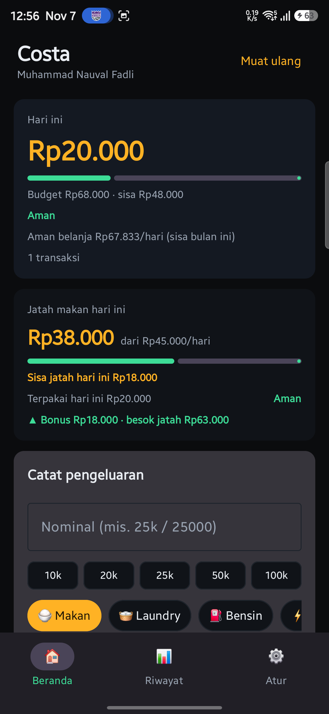
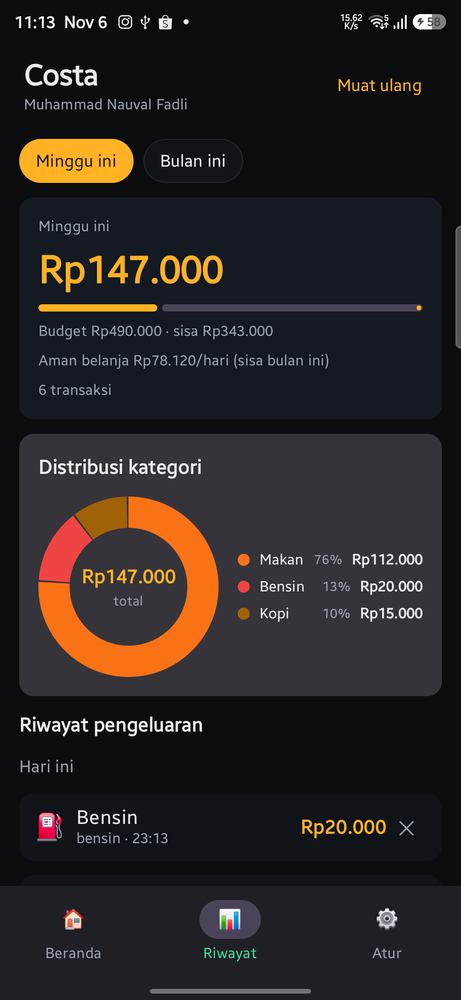
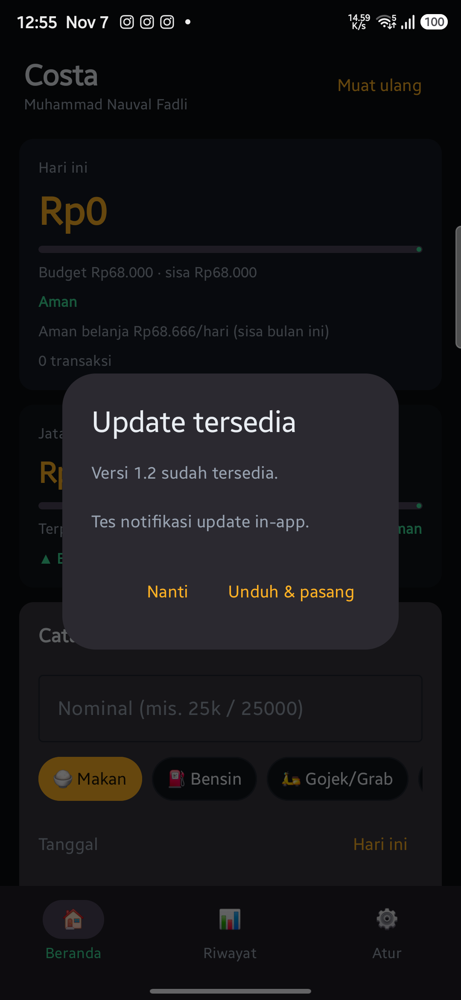

# Costa

A personal expense tracker made for students: a **Laravel API** and a **native Android app** (Kotlin + Jetpack Compose).


## Features

- **Quick add** expenses with smart amount parsing (`25k`, `12.5k`, `25.000`), one-tap amount chips (10k / 20k / 25k / 50k / 100k), category chips, notes, and backdated entries.
- **History & statistics** — daily/weekly/monthly summaries, category **donut chart**, per-category totals, and paginated history with a "load more" control.
- **Budgets by period** — set the monthly budget and its start date; the daily threshold is derived from the remaining days and the weekly threshold is prorated by the number of days in each calendar week. A **rolling daily food allowance** still runs separately: overspending becomes debt, savings become bonus for the next day, with today's remaining allowance on the home card.
- **Multi-user** — each account has isolated expenses, settings, and custom categories; registration is protected by an invite code.
- **Category management** — create, edit, reorder (drag & drop), hide built-in categories or delete your own.
- **Exports** — monthly mutation as **CSV** or **PDF**, saved directly to the phone's Downloads folder.
- **Notifications** — evening reminder when nothing is logged, budget warnings (70/80/100%), weekly recap, and a monthly budget reset reminder.
- **In-app updates** — the app checks the server for a newer APK, shows a changelog dialog, and installs the update without leaving the app.
- **Haptic feedback** — curated ticks, confirmations and error haptics for primary actions, with a toggle in Settings.
- **Dark UI** with a graphite + amber theme, pull-to-refresh, and Android 15+ edge-to-edge support.

## Screenshots

| Home & food allowance | Category distribution |
|---|---|
|  |  |

| In-app update |
|---|
|  |

## Architecture

```
android/   Kotlin + Jetpack Compose app (Retrofit, WorkManager notifications)
backend/   Laravel API (Sanctum tokens, SQLite, DomPDF, CSV export)
           deployed with Docker behind a Cloudflare Tunnel
```

- The Android app talks to the REST API with a per-device Sanctum token.
- Summaries, rolling food allowance and exports are computed server-side so every client stays consistent.
- SQLite keeps deployment simple for a private, two-user setup; the schema is portable to MySQL/PostgreSQL.

### API overview

| Method | Endpoint | Purpose |
|---|---|---|
| `POST` | `/api/login`, `/api/register` | Authentication (invite code required) |
| `GET` | `/api/summary?period=today\|week\|month` | Totals, budgets, food allowance |
| `GET/POST/PATCH/DELETE` | `/api/expenses` | Expense CRUD |
| `GET/POST/PUT/DELETE` | `/api/categories` | Category CRUD, ordering, hiding |
| `GET/PUT` | `/api/settings` | Budget period, monthly budget, food allowance |
| `GET` | `/api/export/csv`, `/api/export/pdf` | Monthly mutation export |
| `GET` | `/api/app-version` | Latest APK metadata for in-app updates |

## Running locally

### Backend

```bash
cd backend
composer install
cp .env.example .env
php artisan key:generate
php artisan migrate --seed
php artisan serve --port=8000
```

Set `COSTA_INVITE_CODE` in `.env` to enable self-registration.

### Android

Open `android/` in Android Studio (JetBrains Runtime 21) and run on a device with **minSdk 35**. The default API base URL is `https://costa.opankcs.com/` and can be changed from the login screen or Settings.

Build a debug APK:

```bash
cd android
./gradlew assembleDebug
```

## Deployment & updates

- Backend: `docker compose up -d --build` on the server; SQLite is persisted through a bind mount.
- APK: upload to `backend/storage/app/public/costa.apk`; the app downloads it from `/download/costa.apk`.
- Release metadata lives in `backend/storage/app/app-version.json`; see `backend/DEPLOY.md` for the release checklist.

## License

MIT — see [LICENSE](LICENSE).
